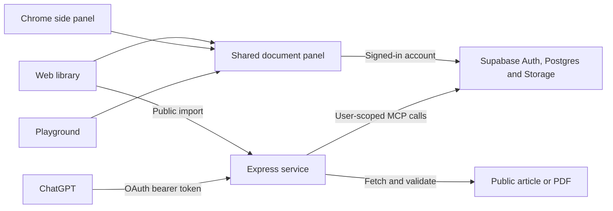

# Architecture

Web Comments has three interfaces that share capture and commenting code. The Express service serves the built website and Chrome ZIP, imports public documents, and exposes the MCP endpoint. Supabase supplies email authentication, Postgres, private file storage, and Realtime.

The playground’s sample mode uses an in-memory store. Its account mode and the other two interfaces persist data to Supabase.

## Code map

| Area | Files and responsibilities |
|---|---|
| HTTP service | [`server/index.ts`](../server/index.ts) serves pages, validates import sessions, and checks MCP bearer tokens. |
| Importer | [`server/public-document.ts`](../server/public-document.ts) handles public URLs, address validation, redirects, and download limits. [`server/import-document.ts`](../server/import-document.ts) selects the enabled article converters or returns PDF bytes. |
| Web entry points | [`src/library.tsx`](../src/library.tsx) implements the library and reader. [`src/library-data.ts`](../src/library-data.ts) loads private library records and files. [`src/playground.tsx`](../src/playground.tsx) mounts the sample. [`src/web.ts`](../src/web.ts) handles the home page, signup and sign-in, saved references, and OAuth consent. |
| Shared UI and persistence | [`src/document-panel.tsx`](../src/document-panel.tsx) owns selection actions, comment threads, and reply rendering. [`src/side-panel.tsx`](../src/side-panel.tsx) provides the shared shell. [`src/comment-store.ts`](../src/comment-store.ts) reads and writes Supabase comments. [`src/sample-comments.ts`](../src/sample-comments.ts) implements the sample store. |
| Capture engines | [`src/html-document.ts`](../src/html-document.ts) reads visible DOM text and anchors ranges. [`src/pdf-document.ts`](../src/pdf-document.ts) uses PDF.js for page rendering, text extraction, and selection geometry. [`src/model.ts`](../src/model.ts) defines captures, anchors, threads, and messages. |
| Chrome MV3 | [`src/manifest.json`](../src/manifest.json) declares the extension. [`src/panel.tsx`](../src/panel.tsx) adapts the active tab to the shared panel. [`src/content.ts`](../src/content.ts) handles webpage capture and highlighting. [`src/viewer.ts`](../src/viewer.ts) provides the extension PDF viewer. |
| Account access | [`src/account-form.tsx`](../src/account-form.tsx) shows signup, OTP verification, and sign-in. [`src/client.ts`](../src/client.ts) handles Auth, Storage, and snapshot RPCs. [`src/background.ts`](../src/background.ts) and [`src/extension-auth.ts`](../src/extension-auth.ts) implement the Chrome session handoff. |
| MCP and schema | [`server/review.ts`](../server/review.ts) defines tools and the review prompt. [`supabase/migrations/`](../supabase/migrations/) contains the schema, access policies, review RPCs, and library RPC. |
| Build | [`build.mjs`](../build.mjs) bundles server, web, and extension entry points with esbuild and packages the extension. |

## HTTP routes

| Route | Contract |
|---|---|
| `GET /`, `/library`, `/playground` | Home page, private library, and interactive sample. |
| `GET /signup`, `/sign-in`, `/extension/sign-in` | Account forms. The extension route expects a challenge from the Chrome service worker. |
| `GET /p/:id` | Account-scoped saved page metadata and the original source link. The library reader opens saved imports from `/library?document=<id>`. |
| `POST /api/import` | Requires an authenticated bearer token and confirmed email. Accepts `{"url":"…","mode":"both"}`. Modes are `both`, `reader`, and `archive`. The server enforces its configured single mode. Older requests using the optional `archive` boolean still work. Returns HTML snapshot JSON or PDF bytes with the final URL in `X-Web-Comments-Source`. The browser saves the resulting document. |
| `GET /config.json` | Public runtime config with API origin, publishable key, app origin, article mode, and optional OAuth client ID. |
| `GET /healthz` | Readiness check that calls the public database health RPC. |
| `GET /downloads/chrome-extension.zip` | ZIP generated by the build. |
| `/mcp`, `/oauth/consent` | MCP transport and OAuth consent. Protected resource metadata is at `/.well-known/oauth-protected-resource` and its `/mcp` variant. |
| `POST /auth/username-login` | Compatibility route for older username-based clients. New accounts use email. |

## Import, capture, and comments

1. In the library, the browser sends an authenticated import request. The server fetches the public URL and returns the enabled article representations or a PDF. The browser renders the initial representation and captures the version text. Chrome captures the active page directly or passes the source to its PDF viewer.
2. The browser hashes the captured text and builds a fingerprint from the text and capture metadata. Imported HTML also includes the markup hash in its fingerprint. `wc_capture` reuses the current version when its fingerprint and title match. A change creates a new version. `wc_save_import` wraps the capture and associates that version and its reader markup with the account’s library in one database transaction.
3. `wc_add_message` creates a thread on a version or appends to an existing thread. The client supplies a stable message UUID so a retry for the same page and ID reuses the message. Each comment containing the `@AI` marker becomes a question. A question is pending while it has no linked assistant reply. Resolving a thread also preserves its discussion.
4. When a document opens, the panel reloads threads for that account’s source URL and restores its highlights. It refreshes on Realtime events and through a polling fallback.

An HTML anchor stores the selected text, offsets, and surrounding text. On reopen, the capture engine uses the context to distinguish repeated passages. A PDF anchor stores the document’s binary hash, page number, selected text, and normalized highlight rectangles. A different PDF binary or changed HTML text can leave a thread without a matching highlight.

The importer accepts public HTTP and HTTPS URLs with standard ports. It checks each redirect and resolves the hostname before connecting to a validated public address. It sends no browser credentials, and enforces a timeout, download limits, and concurrent import limits. HTML is cleaned on the server and sanitized again before browser rendering. The reader preserves document structure and reconstructs it with the app’s styles. Embedded content and scan-only PDFs can leave text extraction incomplete.

### Article layouts

| Layout | Server conversion | Browser rendering |
|---|---|---|
| Reader | `server/article-reader.ts` uses article extraction, `article-layout.ts`, and `reader-image.ts`. | `src/reader-layout.tsx` renders HTML sanitized by `article-sanitizer.ts`. |
| Saved layout | `server/article-archive.ts` preserves the source DOM and bundles static styles, images, and fonts. | `src/saved-layout.tsx` mounts `archive-frame.ts` in a scriptless sandbox. `archive-storage.ts` handles the private bundle. |

Both converters take the original source and the bounded public resource loader. In `both` mode each can succeed independently. In a single-mode deployment only the selected converter runs. PDFs have their own path. The runtime selection points are `server/import-document.ts` and `src/article-view.tsx`. To retire a converter, first select the other mode in production. Keep the loader for previously saved versions or migrate those copies before removing their renderer.

Only the active view is mounted. The first capture records the visible document text in `wc_versions`, using Reader when both representations exist and the saved frame for an archive-only import. Later selections are matched to that pinned text using their quotation and context. Switching the active view keeps the version, offsets, and comment threads. The library remembers the selection in browser local storage.

The archive digest participates in the import fingerprint. The browser uploads the immutable bundle to `<user-id>/archives/<version-fingerprint>.json` in private Storage before saving the version. Reopening verifies the digest and fingerprint. Archive-only imports store a bounded, escaped text fallback in the existing HTML column. Earlier Reader imports and saved text fallbacks remain readable when switching the deployment mode. The complete text used for annotations remains with the version. Reader-only deployments skip archive downloads.

The saved frame is served by `/archive-frame`. Its HTTP policy permits inline CSS and embedded images and fonts. The parent sanitizes the archived DOM, handles external links, and reads selections. Publisher scripts are disabled.

## Data model and ownership

| Table or bucket | Role |
|---|---|
| `wc_pages` | One record per account and source URL. `latest_version` identifies the current capture. |
| `wc_versions` | A saved title, content hash, fingerprint, extraction state, and inline text or file paths. |
| `wc_library` | A private shelf entry for each import. It points to the imported version and stores sanitized HTML for article imports. A later extension capture can update the page’s latest version while the library still opens its imported snapshot. |
| `wc_threads`, `wc_messages` | Thread anchors and ordered user messages. Assistant messages link to the original question and the review that produced the reply. |
| `wc_reviews`, `wc_review_items` | The fixed version and frozen discussion for a review, along with its two read cursors. |
| Private `web-comments` bucket | Content-addressed objects in the account’s path. Text over 512,000 bytes uses `<user-id>/<text-hash>.txt`. PDFs use `<user-id>/<binary-hash>.pdf`. |

Reads use row-level security. Mutations go through RPCs that check the authenticated user ID. Browser capture and comment RPCs reject OAuth client sessions. Review RPCs require an OAuth session and enforce account ownership. Storage policies scope access to the signed-in user’s directory. The server uses the publishable key and the caller’s token for account-scoped operations.

## Email authentication and Chrome handoff

Supabase creates accounts with email and password. The form verifies codes with `verifyOtp` using type `email`, and resends confirmations with type `signup`. The OTP is entered on the same page. The template in `supabase/templates` controls the delivered email. Earlier migrations preserve compatibility with historical owner and username flows. Current accounts sign up directly by email.

For Chrome sign-in, the service worker opens an ordinary tab and records a short-lived challenge in extension session storage. The website obtains the session on that tab and relays it through the content script. The worker checks the tab ID, top-level frame, origin, path, expiry, and one-time challenge before saving the session in extension storage. The panel then refreshes its session.

## MCP review lifecycle

1. `resolve_page(reference)` accepts a page UUID or a link on the configured app origin. It creates a review tied to the latest saved version. The database captures the discussion and pending IDs in the same snapshot. Copying the link from the view you intend to review saves that view first.
2. Fetch `get_page_content(review_id, cursor)` and `list_comments(review_id, cursor)` from cursor zero. The streams can run concurrently. Within each stream, follow its own `next_cursor` until it reports completion. Content chunks contain up to 10,000 characters. Discussion chunks contain up to two records and include the pending question IDs for those records.
3. Review the full document and discussion, including resolved threads and earlier replies. The MCP prompt supports reading both streams in parallel and coordinating work across related questions. Captured material is reference material.
4. Call `post_reply(review_id, comment_id, body)` for each pending question. The database checks that both streams were read and the extraction was complete. A unique constraint ensures only one assistant reply per question, including concurrent retries. A follow-up with `@AI` is a new question and is picked up by a fresh review.

MCP connections use Supabase OAuth tokens. The HTTP layer checks that the token belongs to the configured client and matches the Supabase issuer, authenticated role and audience, and current user. The database and Storage remain scoped to that user throughout the review. A saved page UUID identifies a record. Access comes from authentication and account ownership.

## Test coverage

- [`tests/import-document.test.mjs`](../tests/import-document.test.mjs) checks URL and network boundaries and HTML sanitization.
- [`tests/extension-auth.test.mjs`](../tests/extension-auth.test.mjs) runs the built service worker with fixture browser APIs and verifies the one-time session handoff.
- [`tests/review.test.mjs`](../tests/review.test.mjs) applies migrations to PGlite and checks account isolation, library snapshot pinning, MCP metadata and prompt, capture integrity, ordered review access, and reply idempotency.

Use the [verification checklist](setup.md#verification-checklist) for live Auth delivery, real browser behavior, and ChatGPT acceptance.
