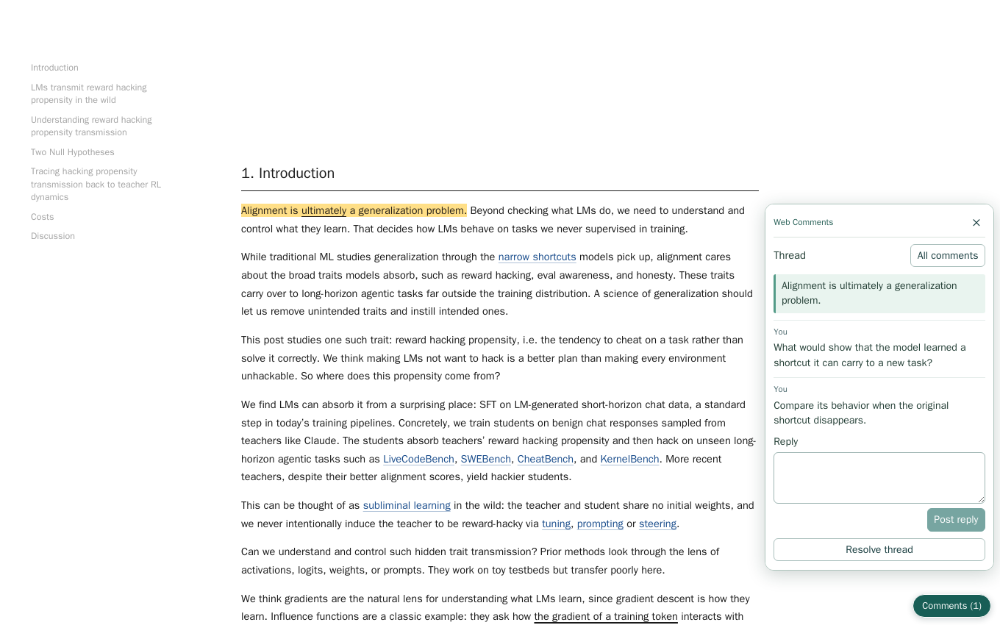
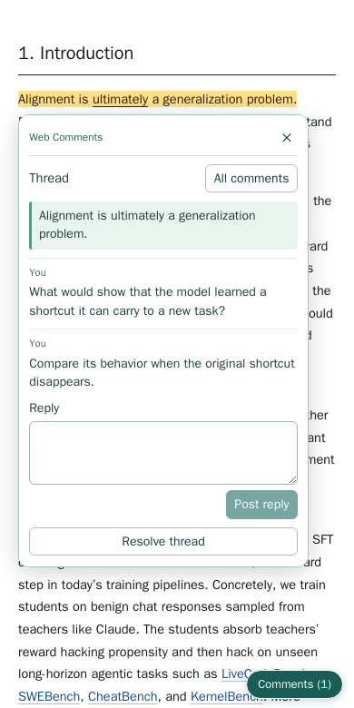
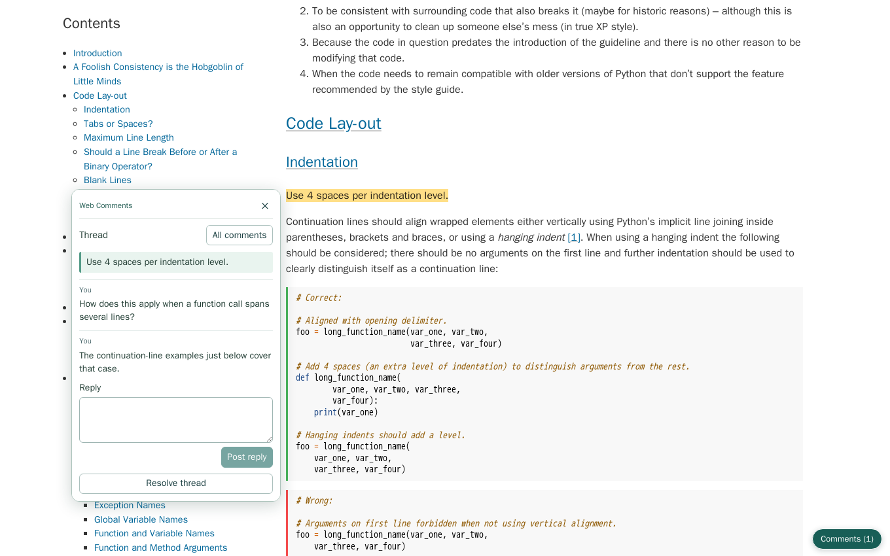
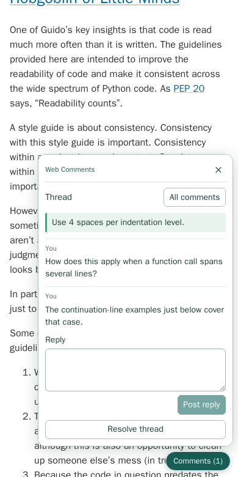
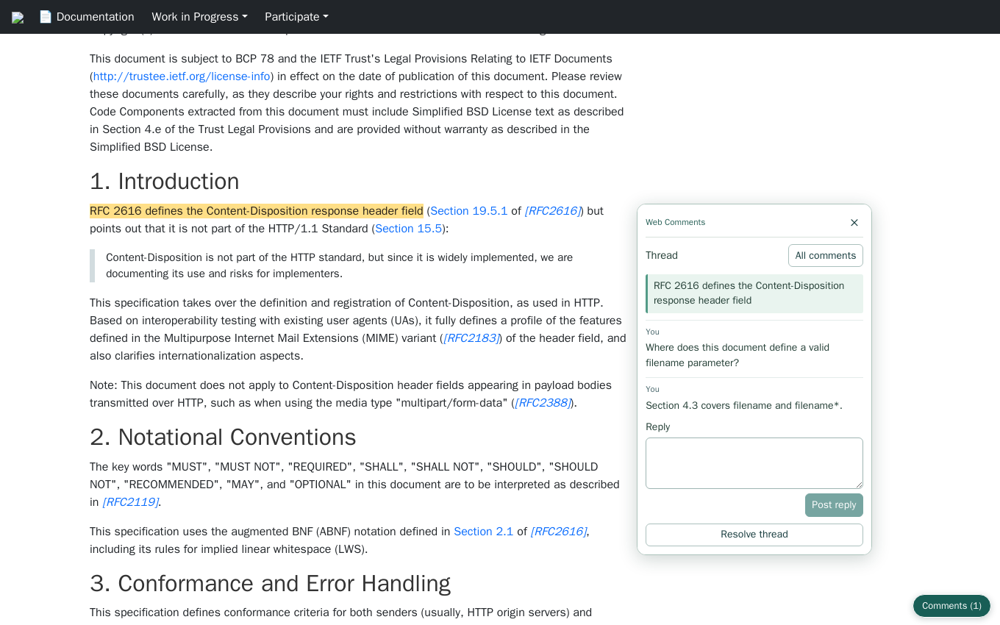
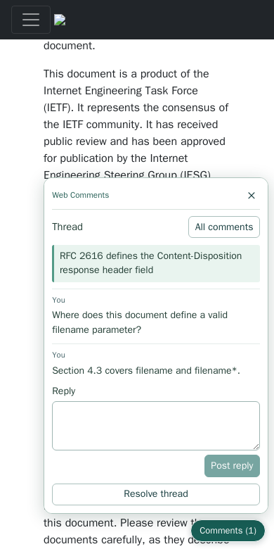
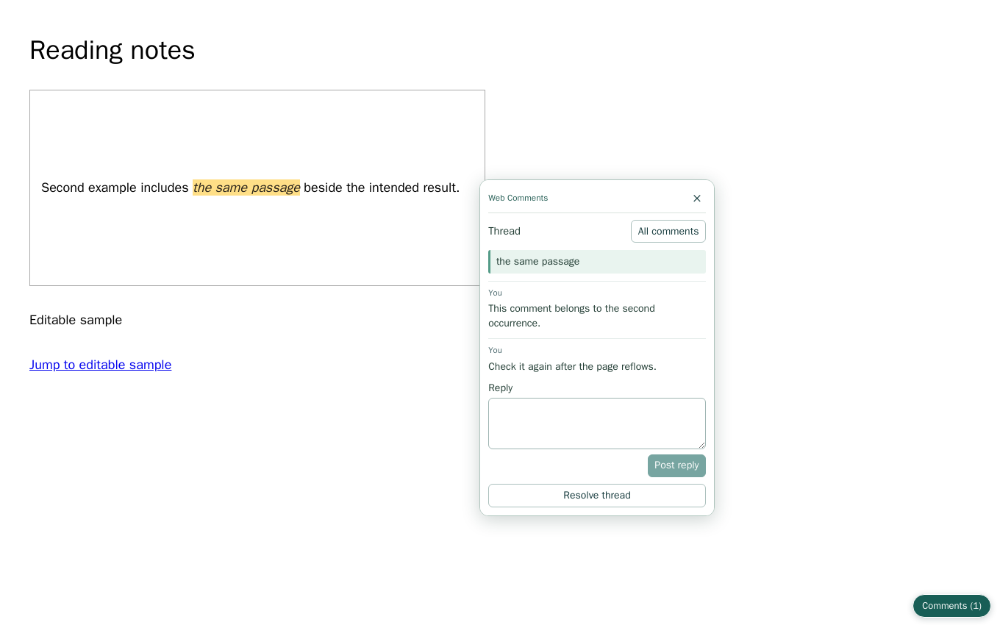
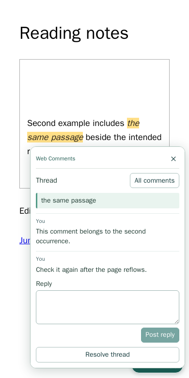

# In-page comments in Chromium

The unpacked extension saved each of these discussions to a separate local Supabase. The three published pages use pinned copies of their HTML and styles. The fourth page exercises duplicate text, nested scrolling, DOM changes and navigation.

Each pair shows the same thread at 1360 × 850 and 390 × 780. Select an image to view it at full size.

## Reward hacking propensity

select, post and reply · anchored card and highlight · narrow viewport · reload, open from marker and from highlighted text · resolve and reopen.

## PEP 8

select, post and reply · anchored card and highlight · narrow viewport · reload, open from marker and from highlighted text · resolve and reopen.

## HTTP RFC 6266

select, post and reply · anchored card and highlight · narrow viewport · reload, open from marker and from highlighted text · resolve and reopen.

## Nested scroll and repeated text

select, post and reply · anchored card and highlight · narrow viewport · reload, open from marker and from highlighted text · duplicate quote, DOM replacement, scroll clipping, missing passage · resolve and reopen · editable fields, single-page navigation.

